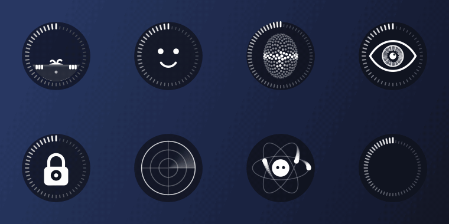
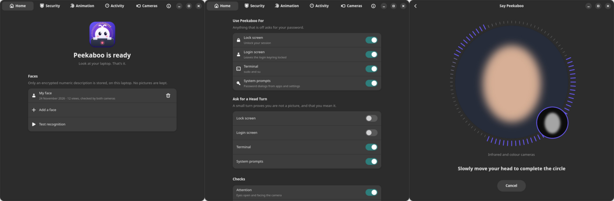
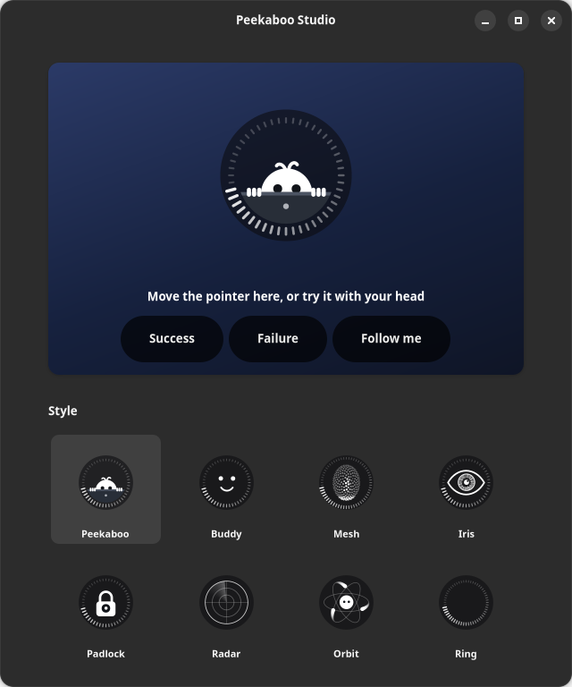

<h1 align="center">Peekaboo</h1>

<b>Unlock your Linux laptop by looking at it.</b> 
Infrared face unlock for the lock screen, login, <code>sudo</code> and system prompts.

<a href="https://hesam-deb.github.io/peekaboo/">Website</a> · <a href="persian.md">فارسی</a>

Peekaboo uses the infrared camera that Windows Hello laptops have. It recognises you only by
light that its own flickering emitter sent out and got back, so it works in the dark and is
blind to faces on screens. A little friend on your screen looks back at you while it does.

* **Both cameras to register, infrared to unlock.** While you register, the colour camera
  watches along and the two must agree that it is one face. Only the infrared views are
  stored, and only infrared is ever used to unlock.
* **Everywhere, or only where you want.** Lock screen, login screen, terminal, system prompts.
* **A head turn for what matters.** `sudo` and system prompts ask for a small turn of the head:
  proof that you are not a picture, and that you mean it.
* **It follows you.** Eight animations mirror how you turn your head and when you blink. A
  studio with a live preview makes them yours.
* **Nothing to steal.** No pictures are kept, only numbers, encrypted with a key sealed to the
  TPM, behind a sandboxed service.
* **Falls back to your password**, always. In a terminal you can simply type it while the
  camera looks.

## Install

Needs an infrared camera, Python 3.11, OpenCV 4.8 and systemd: **Debian 13, Ubuntu 24.10 or
newer**. Animations need GNOME 48 to 50 (tested on 50).

Download the `.deb` from [Releases](https://github.com/Hesam-deb/peekaboo/releases):

    sudo apt install ./peekaboo_1.1.0_amd64.deb      # or arm64

or build it:

    git clone https://github.com/Hesam-deb/peekaboo && cd peekaboo
    make models            # three pinned models, 38 MB
    sudo ./install.sh

Then:

    peekaboo doctor        # does everything check out?
    peekaboo gui           # set up your face, try it
    peekaboo animation on  # GNOME; log out and in once

and switch it on, **keeping a root shell open** until you know you can still get in:

    sudo pam-auth-update --enable peekaboo peekaboo-password

Both profiles are needed: the second notices when you type your password, which Peekaboo wants
once after every boot. To undo it, use `--disable`. `sudo ./uninstall.sh` or `apt remove`
takes everything out, PAM first.

Fedora, Arch and others

`make && sudo make install && sudo /usr/lib/peekaboo/setup`, then add to the `auth` part of
your PAM stack (`authselect` custom profile, `/etc/pam.d/system-auth`, ...) in front of and
after `pam_unix`:

    auth  sufficient  pam_peekaboo.so
    auth  ...         pam_unix.so ...
    auth  optional    pam_peekaboo.so note_password

`note_password` must only be reached when the password was right. With SELinux, load
`packaging/selinux/peekaboo.te` so that login screens may talk to the service. None of this
has been tried on a running system yet; reports are welcome.

## Use

| | |
|---|---|
| `peekaboo gui` | the app |
| `peekaboo enroll [NAME]` | register a face (`--ir-only` leaves the colour camera out) |
| `peekaboo test` | try it, with scores |
| `peekaboo use lock shell` | use it only there; also `login`, `system`, `all`, `none` |
| `peekaboo set head-turn shell system` | where to ask for a head turn |
| `peekaboo set level high` | `standard`, `high` or `maximum` strictness |
| `peekaboo set attention off` | do not require open eyes |
| `peekaboo cameras --probe` | what was found, and why |
| `peekaboo history` | recent unlocks |
| `peekaboo animation studio` | customise the animation |

Loosening anything asks for your password; tightening does not. Administrators can set limits
for everyone in `/etc/peekaboo/config.toml`.

## Animations

Peekaboo, Buddy, Mesh, Iris, Padlock, Radar, Orbit and Ring; four celebrations; colours or
your system accent; size, position, speed, backdrop, captions and greeting; on the lock screen,
in system prompts, for the terminal, or any of them.

The service reports which way your head points, where it is in the picture and whether your
eyes are open, about seven times a second while it scans. (Head direction, not eyeball
direction: the infrared picture is too coarse for that.) The GNOME extension reads this from a
small file and draws in its own click-through layer. It patches nothing and starts nothing, so
it cannot get in the way of a password prompt.

## Cameras

Cameras are found by what they say about themselves: greyscale-only formats, the Windows Hello
control, their name, their USB module. When that is not conclusive, Peekaboo looks through them
(is the picture monochrome?). It handles

* 8 to 16 bit grey, YUYV/UYVY, NV12/I420, MJPEG and RGB infrared streams,
* emitters that fire every other frame, in pairs, or one frame in three, and ones always on,
* sensors mounted sideways, privacy shutters, cameras that cannot run at the same time,
* `/dev/video` numbers that change from boot to boot.

Faces are tied to the camera they were enrolled with, by USB port and model: plugging in a
device that plays back your face gets nobody in. Virtual cameras are never used.

Not supported: laptops without infrared (a colour camera cannot tell a face from a photo), and
MIPI (IPU6/IPU7) infrared sensors that Linux does not expose.

| Camera | Found in | |
|---|---|---|
| Shinetech `3277:0055` | ASUS Zenbooks | developed on this |

Everything else is simulated in the tests. Please report how yours does, with the output of
`peekaboo cameras --probe`. If the picture stays black, the emitter needs a vendor control; see
`emitter_control` in the configuration, next to `mode`, `exposure` and `black_level` for raw
sensors that need a hand.

## How it works

    sudo, gdm, polkit -> pam_peekaboo.so -> /run/peekaboo/peekaboo.sock -> peekabood
                         small, in C                                       cameras, models,
                                                                           templates

* **Strobe.** Recognition runs on *lit frame minus unlit frames*. A camera that strobed at
  enrolment must strobe at every login, so blinding it with a lamp cannot switch the check off.
* **Head turn.** The nose is measured in the plane of the eyes and mouth. On a flat picture it
  cannot move relative to them, whatever the tilt; on a head it does.
* **Attention.** Eyes open, facing the camera.
* **Second camera, at registration.** Every view is seen by both cameras at the same moment,
  and a pair that does not show one face is thrown away. In the dark, infrared goes alone.
* **Lockout.** Five failures, a reboot or 48 hours ask for the password.
* **At the laptop only.** Not over ssh, not with the lid closed, not for anyone but the person
  whose session is on the screen, and never for PAM services other than the four uses.

## Security

Read this before relying on it.

* There is no depth sensor. This is a convenience, not a replacement for a strong password.
* At the lock and login screens no head turn is asked by default, so a good
  *infrared-reflective print* of your face might pass. Turn the head turn on there to
  make that harder. Curved prints and masks are not defended against.
  **No spoofing with physical artefacts has been tested.**
* Identical twins and close relatives may match.
* A face cannot unlock the GNOME keyring. After a boot you type your password anyway, but
  logging out and back in with your face leaves the keyring locked. `peekaboo use lock shell
  system` avoids it.
* Root can do anything, including read templates while the key is loaded. The TPM key is not
  bound to PCRs (firmware updates would erase your face): it protects a copied disk, not a
  laptop that someone else boots.
* External cameras are weaker than built-in ones, as their port is reachable.

False accepts, one template against one photo, LFW in greyscale (3000 people, 6.8 million
impostor pairs, not filtered for label errors), through this code:

| threshold | false accepts | genuine pairs accepted |
|-----------|---------------|------------------------|
| 0.50      | 3.8e-6        | 89 %                   |
| 0.55      | 2.2e-6        | 82 %                   |
| **0.60**  | 1.6e-6        | 70 %                   |

An enrolment of 12 views is up to 12 times that. The genuine column is press photos years apart
with one template, so it understates real use. These are visible light figures, for lack of a
public infrared set; treat them as a guide.

Found a hole? Please open a
[private advisory](https://github.com/Hesam-deb/peekaboo/security/advisories/new).

## Development

    make test
    export PEEKABOO_DEV=/tmp/pk PEEKABOO_MODELS=$PWD/models PYTHONPATH=$PWD/src
    python3 -P -m peekaboo.daemon &      # unprivileged; access checks off
    python3 -P -m peekaboo.cli test
    gjs -m extension/studio-app.js       # after glib-compile-schemas extension/schemas
