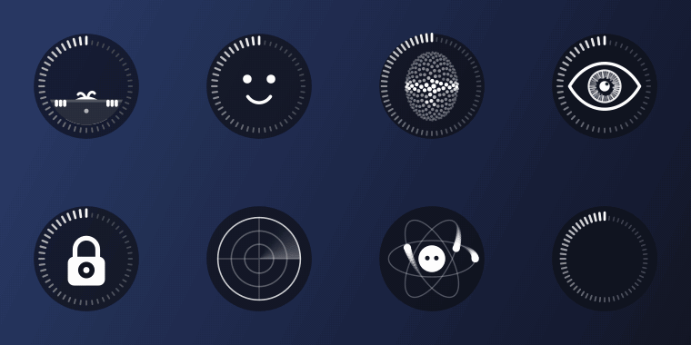
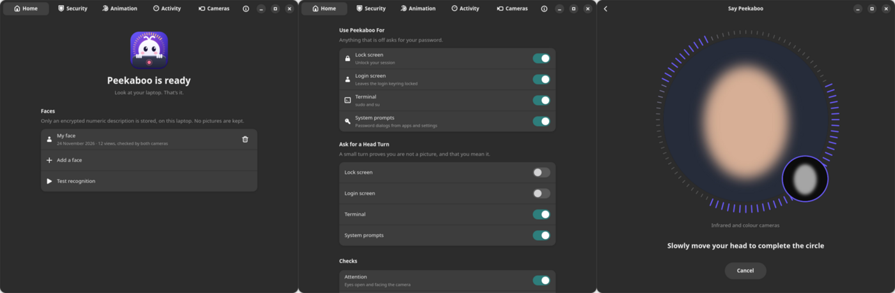
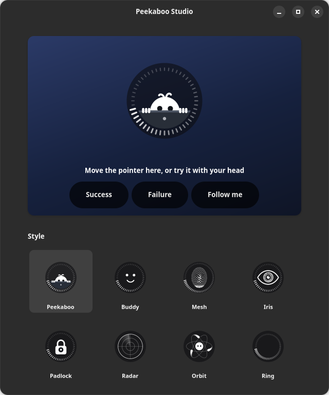

<div dir="rtl">

<p align="center"></p>
<h1 align="center">Peekaboo (پیکابو)</h1>
<p align="center"><b>به لپ‌تاپ لینوکسی‌تان نگاه کنید تا قفلش باز شود.</b><br>
باز کردن قفل با چهره و دوربین مادون‌قرمز، برای صفحهٔ قفل، ورود، <code>sudo</code> و پنجره‌های سیستمی.</p>

<p align="center"><a href="https://hesam-deb.github.io/peekaboo/">وب‌سایت</a> · <a href="README.md">English</a></p>

<p align="center"></p>

پیکابو از دوربین مادون‌قرمز لپ‌تاپ‌های مجهز به Windows Hello استفاده می‌کند. شما را فقط با نوری می‌شناسد که فرستندهٔ چشمک‌زن خودش تابانده و بازتابش را گرفته است. برای همین در تاریکی کار می‌کند و چهره‌های روی نمایشگر را نمی‌بیند. در همین حال، دوست کوچکی روی صفحه به شما نگاه می‌کند.

* **ثبت با دو دوربین، باز کردن با مادون‌قرمز.** هنگام ثبت چهره، دوربین رنگی هم نگاه می‌کند و هر دو باید تأیید کنند که یک چهره می‌بینند. فقط نماهای مادون‌قرمز ذخیره می‌شوند و قفل فقط با مادون‌قرمز باز می‌شود.
* **همه‌جا، یا فقط جایی که بخواهید.** صفحهٔ قفل، صفحهٔ ورود، ترمینال و پنجره‌های سیستمی.
* **چرخش سر برای کارهای مهم.** `sudo` و پنجره‌های سیستمی از شما می‌خواهند سرتان را کمی بچرخانید، تا معلوم شود عکس نیستید و واقعاً قصد این کار را دارید.
* **شما را دنبال می‌کند.** هشت انیمیشن چرخش سر و پلک زدن شما را بازتاب می‌دهند. در استودیو با پیش‌نمایش زنده می‌توانید آن‌ها را به سلیقهٔ خود تغییر دهید.
* **چیزی برای دزدیدن نیست.** هیچ عکسی نگه داشته نمی‌شود. فقط عددهایی ذخیره می‌شوند که با کلیدی مهروموم‌شده در TPM رمزگذاری شده‌اند و پشت یک سرویس ایزوله قرار دارند.
* **رمز عبور همیشه کار می‌کند.** در ترمینال می‌توانید هم‌زمان با نگاه کردن دوربین، رمز را تایپ کنید.



## نصب

به دوربین مادون‌قرمز، Python 3.11، OpenCV 4.8 و systemd نیاز دارد، یعنی **Debian 13 یا Ubuntu 24.10 و جدیدتر**. انیمیشن‌ها به GNOME 48 تا 50 نیاز دارند (روی 50 آزمایش شده).

فایل `.deb` را از [صفحهٔ انتشارها](https://github.com/Hesam-deb/peekaboo/releases) دانلود کنید:

<div dir="ltr">

```sh
sudo apt install ./peekaboo_1.1.0_amd64.deb      # or arm64
```

</div>

یا خودتان بسازید:

<div dir="ltr">

```sh
git clone https://github.com/Hesam-deb/peekaboo && cd peekaboo
make models            # three pinned models, 38 MB
sudo ./install.sh
```

</div>

سپس بررسی کنید که همه‌چیز درست است، چهره‌تان را ثبت کنید و انیمیشن را روشن کنید (پس از آن یک بار از GNOME خارج و دوباره وارد شوید):

<div dir="ltr">

```sh
peekaboo doctor
peekaboo gui
peekaboo animation on
```

</div>

در پایان آن را فعال کنید. **تا وقتی مطمئن نشده‌اید که هنوز می‌توانید وارد شوید، یک ترمینال root را باز نگه دارید:**

<div dir="ltr">

```sh
sudo pam-auth-update --enable peekaboo peekaboo-password
```

</div>

هر دو پروفایل لازم‌اند. دومی متوجه می‌شود که رمزتان را وارد کرده‌اید، چون پیکابو پس از هر بار روشن شدن دستگاه یک بار رمز می‌خواهد. برای غیرفعال کردن از `--disable` استفاده کنید. `sudo ./uninstall.sh` یا `apt remove` همه‌چیز را حذف می‌کند و از PAM شروع می‌کند.

<details><summary>فدورا، آرچ و توزیع‌های دیگر</summary>

<div dir="ltr">

```sh
make && sudo make install && sudo /usr/lib/peekaboo/setup
```

</div>

سپس این خط‌ها را به بخش `auth` در PAM (پروفایل سفارشی `authselect`، فایل `/etc/pam.d/system-auth` و مانند آن)، پیش و پس از `pam_unix` اضافه کنید:

<div dir="ltr">

```
auth  sufficient  pam_peekaboo.so
auth  ...         pam_unix.so ...
auth  optional    pam_peekaboo.so note_password
```

</div>

اجرا باید فقط وقتی به `note_password` برسد که رمز درست بوده باشد. اگر SELinux دارید، `packaging/selinux/peekaboo.te` را بارگذاری کنید تا صفحهٔ ورود بتواند با سرویس ارتباط بگیرد. هیچ‌کدام از این‌ها هنوز روی سیستم واقعی آزمایش نشده است. گزارش شما کمک بزرگی است.

</details>

## استفاده

| دستور | کار |
|---|---|
| `peekaboo gui` | برنامهٔ گرافیکی |
| `peekaboo enroll [NAME]` | ثبت چهره (`--ir-only` دوربین رنگی را کنار می‌گذارد) |
| `peekaboo test` | آزمایش، همراه با امتیازها |
| `peekaboo use lock shell` | استفاده فقط در این بخش‌ها. گزینه‌های دیگر: `login`، `system`، `all` و `none` |
| `peekaboo set head-turn shell system` | جاهایی که چرخش سر خواسته شود |
| `peekaboo set level high` | میزان سخت‌گیری: `standard`، `high` یا `maximum` |
| `peekaboo set attention off` | باز بودن چشم‌ها لازم نباشد |
| `peekaboo cameras --probe` | دوربین‌های پیداشده و دلیل انتخابشان |
| `peekaboo history` | آخرین بازگشایی‌ها |
| `peekaboo animation studio` | سفارشی کردن انیمیشن |

آسان‌تر کردن هر تنظیم امنیتی رمز عبور می‌خواهد، ولی سخت‌تر کردنش نه. مدیر سیستم می‌تواند در `/etc/peekaboo/config.toml` برای همه محدودیت بگذارد.

## انیمیشن‌ها



هشت سبک Peekaboo، Buddy، Mesh، Iris، Padlock، Radar، Orbit و Ring، و چهار حالت جشن. رنگ دلخواه یا رنگ تأکیدی سیستم، اندازه، جا، سرعت، پس‌زمینه، زیرنویس و خوشامد قابل تنظیم است. انیمیشن می‌تواند روی صفحهٔ قفل، در پنجره‌های سیستمی، برای ترمینال یا هر ترکیبی از آن‌ها نمایش داده شود.

سرویس هنگام اسکن، حدود هفت بار در ثانیه، جهت سر، جای آن در تصویر و باز بودن چشم‌ها را گزارش می‌کند. (جهت سر و نه جهت مردمک، چون تصویر مادون‌قرمز برای آن به اندازهٔ کافی دقیق نیست.) افزونهٔ GNOME این داده را از یک فایل کوچک می‌خواند و در لایهٔ جداگانه‌ای می‌کشد که کلیک از آن رد می‌شود. چیزی را وصله یا اجرا نمی‌کند، پس نمی‌تواند مزاحم پنجرهٔ رمز شود.

## دوربین‌ها

دوربین‌ها از روی مشخصات خودشان شناخته می‌شوند: قالب‌های فقط خاکستری، کنترل Windows Hello، نام و ماژول USB. اگر این‌ها کافی نباشد، پیکابو تصویرشان را نگاه می‌کند تا ببیند تک‌رنگ است یا نه. این موارد پشتیبانی می‌شوند:

* جریان‌های مادون‌قرمز خاکستری ۸ تا ۱۶ بیتی، YUYV/UYVY، NV12/I420، MJPEG و RGB،
* فرستنده‌هایی که یک فریم در میان، جفت‌جفت یا یک فریم از هر سه فریم روشن می‌شوند، و فرستنده‌های همیشه روشن،
* حسگرهای نصب‌شده به پهلو، دریچهٔ حریم خصوصی، و دوربین‌هایی که هم‌زمان کار نمی‌کنند،
* شماره‌های `/dev/video` که با هر بار روشن شدن عوض می‌شوند.

هر چهره، با درگاه USB و مدل، به دوربینی وابسته است که با آن ثبت شده. پس وصل کردن دستگاهی که تصویر چهره‌تان را پخش می‌کند به جایی نمی‌رسد. دوربین‌های مجازی هرگز استفاده نمی‌شوند.

پشتیبانی نمی‌شود: لپ‌تاپ‌های بدون مادون‌قرمز (دوربین رنگی نمی‌تواند چهره را از عکس تشخیص دهد) و حسگرهای مادون‌قرمز MIPI (IPU6/IPU7) که لینوکس در دسترس نمی‌گذارد.

| دوربین | در | وضعیت |
|---|---|---|
| Shinetech `3277:0055` | ASUS Zenbook | توسعه روی همین انجام شده |

بقیه فقط در آزمون‌ها شبیه‌سازی شده‌اند. لطفاً نتیجهٔ دوربین خود را با خروجی `peekaboo cameras --probe` گزارش کنید. اگر تصویر سیاه ماند، فرستنده به کنترل ویژهٔ سازنده نیاز دارد. `emitter_control` را در پیکربندی ببینید. برای حسگرهای خام هم `mode`، `exposure` و `black_level` در همان‌جاست.

## چگونه کار می‌کند

<div dir="ltr">

```
sudo, gdm, polkit -> pam_peekaboo.so -> /run/peekaboo/peekaboo.sock -> peekabood
                     small, in C                                       cameras, models,
                                                                       templates
```

</div>

* **نور چشمک‌زن.** تشخیص روی *فریم روشن منهای فریم‌های خاموش* انجام می‌شود. دوربینی که هنگام ثبت چشمک می‌زده باید در هر ورود هم بزند، پس نمی‌توان با تاباندن چراغ این بررسی را از کار انداخت.
* **چرخش سر.** جای بینی نسبت به صفحهٔ چشم‌ها و دهان سنجیده می‌شود. در تصویر تخت، با هر کج کردنی، بینی نسبت به آن‌ها جابه‌جا نمی‌شود، ولی در سر واقعی می‌شود.
* **توجه.** چشم‌ها باز و رو به دوربین.
* **دوربین دوم هنگام ثبت.** هر نما را هر دو دوربین در یک لحظه می‌بینند و جفتی که یک چهره را نشان ندهد کنار گذاشته می‌شود. در تاریکی فقط مادون‌قرمز کار می‌کند.
* **قفل شدن.** پس از پنج تلاش ناموفق، راه‌اندازی دوباره یا ۴۸ ساعت، رمز عبور لازم است.
* **فقط پای لپ‌تاپ.** نه از راه ssh، نه با درِ بسته، نه برای کسی جز صاحب نشستی که روی صفحه است، و نه برای سرویس‌های PAM بیرون از این چهار کاربرد.

## امنیت

پیش از تکیه کردن بر پیکابو این بخش را بخوانید.

* حسگر عمق وجود ندارد. این ابزار برای راحتی است و جای رمز عبور قوی را نمی‌گیرد.
* در صفحهٔ قفل و ورود، چرخش سر به‌طور پیش‌فرض خواسته نمی‌شود، پس یک *چاپ خوب از چهره‌تان که مادون‌قرمز را بازتاب دهد* ممکن است پذیرفته شود. برای سخت‌تر کردن این کار، چرخش سر را آنجا روشن کنید. در برابر چاپ خمیده و ماسک محافظتی نیست. **هیچ آزمایشی با نمونه‌های فیزیکی جعل چهره انجام نشده است.**
* دوقلوهای همسان و خویشاوندان نزدیک ممکن است پذیرفته شوند.
* چهره نمی‌تواند جاکلیدی GNOME را باز کند. پس از روشن شدن دستگاه به هر حال رمز را وارد می‌کنید، ولی اگر خارج شوید و با چهره برگردید جاکلیدی قفل می‌ماند. `peekaboo use lock shell system` جلوی این را می‌گیرد.
* کاربر root هر کاری می‌تواند بکند، از جمله خواندن الگوها وقتی کلید بارگذاری شده است. کلید TPM به PCRها وابسته نیست (وگرنه به‌روزرسانی فرم‌ور چهره‌تان را پاک می‌کرد). پس از دیسکِ کپی‌شده محافظت می‌کند، نه از لپ‌تاپی که کس دیگری روشنش کند.
* دوربین‌های بیرونی ضعیف‌تر از دوربین‌های داخلی‌اند، چون درگاهشان در دسترس است.

پذیرش نادرست، یک الگو در برابر یک عکس، مجموعهٔ LFW به‌صورت خاکستری (۳۰۰۰ نفر، ۶٫۸ میلیون جفت ناهمسان، بدون پالایش خطاهای برچسب)، با همین کد:

| آستانه | پذیرش نادرست | پذیرش جفت‌های واقعی |
|---|---|---|
| 0.50 | 3.8e-6 | 89% |
| 0.55 | 2.2e-6 | 82% |
| **0.60** | 1.6e-6 | 70% |

در ثبت ۱۲‌نمایی، پذیرش نادرست تا ۱۲ برابر این است. ستون آخر از عکس‌های خبری با فاصلهٔ چند سال و تنها یک الگوست و کمتر از کاربرد واقعی نشان می‌دهد. چون مجموعهٔ عمومی مادون‌قرمز در دسترس نبود، این عددها برای نور مرئی‌اند. آن‌ها را تنها راهنما بدانید.

حفرهٔ امنیتی پیدا کردید؟ لطفاً یک [گزارش خصوصی](https://github.com/Hesam-deb/peekaboo/security/advisories/new) باز کنید.

## توسعه

<div dir="ltr">

```sh
make test
export PEEKABOO_DEV=/tmp/pk PEEKABOO_MODELS=$PWD/models PYTHONPATH=$PWD/src
python3 -P -m peekaboo.daemon &      # unprivileged; access checks off
python3 -P -m peekaboo.cli test
gjs -m extension/studio-app.js       # after glib-compile-schemas extension/schemas
```

</div>

</div>
